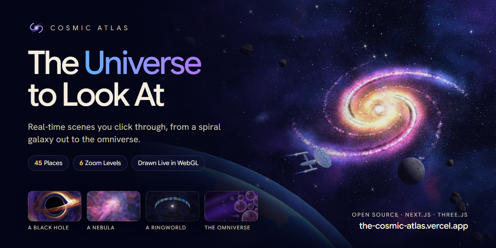
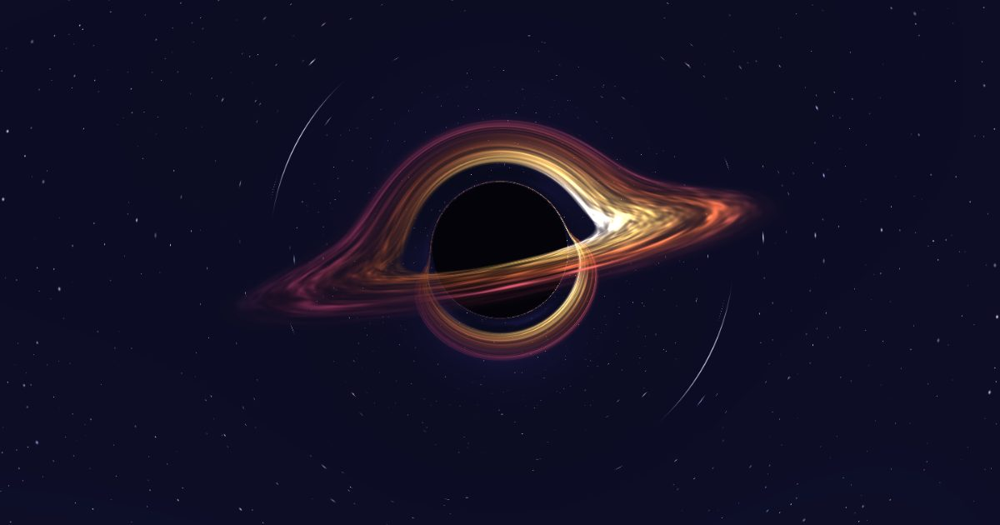
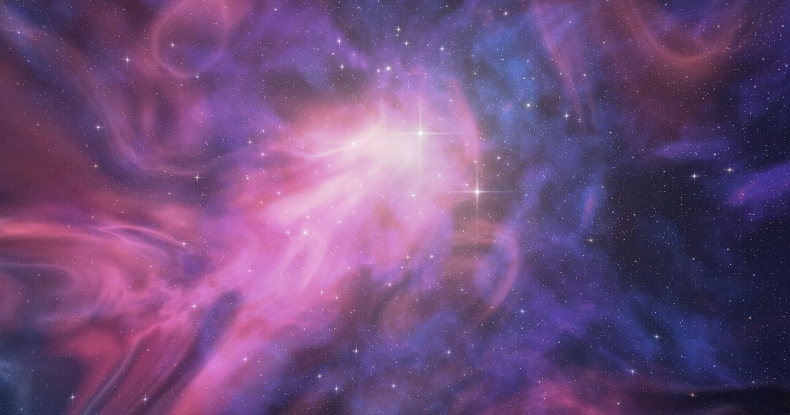
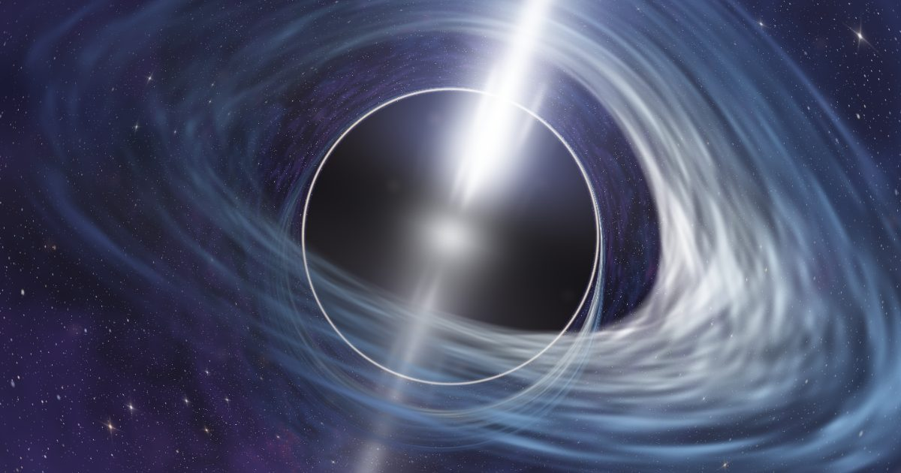

# Cosmic Atlas: The Universe to Look At

A spectacle of the cosmos you click through: real-time scenes from a spiral galaxy out to the observable universe, the multiverse and the omniverse beyond it, and down into the strange places inside them, each move a smooth flight.

**[Fly through it live](https://the-cosmic-atlas.vercel.app)** · real-time WebGL · Next.js · React Three Fiber



| A Black Hole | A Nebula | A Quasar |
|---|---|---|
|  |  |  |

## Project Overview

Cosmic Atlas is a website for looking at the universe rather than reading about it. Pick a ship, press Begin and fly into a galaxy. Click a glowing point to dive into a black hole, a nebula or a solar system, or Zoom Out through the cosmic web and the observable universe to a line of other universes and the omniverse beyond. A wormhole leads to a stranger galaxy of quasars, megastructures and big ideas, and guided flights and a hands-off tour show you around.

Every scene is drawn live in the browser with WebGL shaders, with no photos or downloaded images, so it stays original and small. Each view has only a name and one short line, and every line is checked against a real source. Under every scene plays a soft hush of deep space. If 3D can't run, every page still shows a still image and works as plain HTML.

**Status:** live at https://the-cosmic-atlas.vercel.app, still being polished. 6 zoom levels, 45 places, two guided flights and a hands-off tour are built. What's next is in `context/PROGRESS_TRACKER.md`.

## Ideas That Shape It

- **Cosmos alone.** The scenery fills the screen, with nothing drawn over it. Each view has a name and one line.
- **Click to travel.** Pull back from the galaxy to the cosmic web, or click a light to fall into it: the camera dives in, the screen passes through the place's own colour, and the place grows into view.
- **Honest in its few words.** Every line is tied to a checked source; every picture is an illustration.
- **Look around and listen.** Drag to turn a scene, use the wheel to zoom, and hear music and a whoosh on every flight.
- **Works without 3D.** Every screen is complete HTML with a still of its scene; the live scenes adapt to the device.

## Tech Stack

Next.js 16 (App Router), React 19, TypeScript, CSS Modules, three with React Three Fiber. Built with Claude Code.

## Documents

| File | What it covers |
|---|---|
| `AGENTS.md` | Rules for AI coding agents (`CLAUDE.md` imports it) |
| `context/PROGRESS_TRACKER.md` | Where the work stands, the plan, the session log |
| `context/BLUEPRINT.md` | Vision, scope, editorial and sourcing rules |
| `context/DESIGN_SPEC.md` | Visual language, each screen, the flow, the screenshot checklist |
| `context/ARCHITECTURE.md` | Stack, structure, scene system, performance budgets |
| `context/DECISIONS.md` | Why things are the way they are |
| `context/SHIP_BRIEF.md` | The design brief for the five ships |
| `context/IDEAS.md` | Idea bank of future places |

## Running It

Needs Node 20.9 or newer. `npm run dev` serves the site at http://localhost:3000.

```
npm install
npm run dev
```

| Script | What it does |
|---|---|
| `npm run check` | Type check, lint and the sourcing check on every line (fast, no build) |
| `npm run build` | Production build (every route is static) |
| `npm run shots` | Starts the built app and screenshots each route at 1440x900, 390x844 and 1440x900 with reduced motion into `screenshots/` |
| `npm run posters` | Renders scene stills into `public/posters/` from the built app's own scenes; build again afterwards |
| `npm run fallbacks` | Runs the scene tests on the built app: reduced motion, no WebGL, slow device, no 3D code on the 404 page, every place, the flow between scenes with and without motion, keyboard only and touch only |
| `npm run a11y` | Scans every route with axe-core, wide and on a phone; fails on serious or critical findings |
| `npm run social` | Renders the share card (`scripts/social-card.html`, over the scene stills) at 1280x640 into `.github/social-preview.png` (upload it in GitHub under Settings, Social preview) |

`npm run shots` uses Playwright's Chromium; run `npx playwright install chromium` once if it is missing.

## Deploying

The site is a Vercel project (`vercel deploy --prod`; `.vercelignore` keeps the docs and screenshots out of the upload). Canonical links, Open Graph tags, the sitemap and robots.txt use `NEXT_PUBLIC_SITE_URL` when it is set, and otherwise the Vercel project's production domain; a build anywhere else points them at a placeholder on `cosmic-atlas.example`.

All imagery is original illustration. Nothing here is a telescope photograph.

## Contributing

Cosmic Atlas is open source and contributions are welcome: new places, better scenes, faster shaders, fixes. Read [CONTRIBUTING.md](CONTRIBUTING.md) for setup and the house rules (every fact sourced, our own art only, nothing drawn over the cosmos), and look at `context/IDEAS.md` for places waiting to be built.

## License

The code is [MIT](LICENSE). The sound effects in `public/audio/effects/` are not covered and must not be reused.

---

> *"Indeed, in the creation of the heavens and the earth and the alternation of the day and night there are signs for people of reason."*
> — Quran 3:190, The Clear Quran ([on Quran.com](https://quran.com/3/190))
